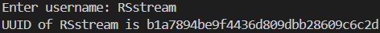

# Minecraft UUID lookup

> A UUID lookup made for Minecraft, using Python 3.

When you run the program, just type the username and it will tell you the UUID, or just tell you the username doesn't exist.

### Libraries used:
- `requests`

### What it looks like:
